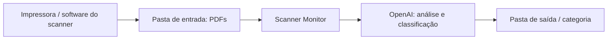

# Scanner Monitor

Organizador de documentos digitalizados, desenvolvido em **Go**, que monitora uma pasta de entrada, classifica PDFs com a **API da OpenAI** e move os arquivos para pastas por tipo de documento.

O objetivo é reduzir o trabalho manual depois de usar o scanner de uma impressora: em vez de procurar arquivos avulsos e separar cada documento, o programa organiza os PDFs conforme seu conteúdo.

> **Status:** projeto em desenvolvimento. Os diretórios são configurados pelo `.env`, e 20 workers processam os PDFs continuamente. Consulte as [limitações atuais](#limitações-atuais) antes de usar.

## Sumário

- [Como funciona](#como-funciona)
- [Categorias de documentos](#categorias-de-documentos)
- [Tecnologias](#tecnologias)
- [Pré-requisitos](#pré-requisitos)
- [Instalação e configuração](#instalação-e-configuração)
- [Execução](#execução)
- [Estrutura do projeto](#estrutura-do-projeto)
- [Verificação](#verificação)
- [Limitações atuais](#limitações-atuais)
- [Solução de problemas](#solução-de-problemas)
- [Cuidados antes de publicar no GitHub](#cuidados-antes-de-publicar-no-github)
- [Próximas melhorias](#próximas-melhorias)

## Como funciona

1. O software da impressora salva os documentos digitalizados em PDF na pasta de entrada.
2. O Scanner Monitor verifica essa pasta a cada **dois segundos**.
3. Cada novo PDF é aberto e enviado à API da OpenAI.
4. O modelo analisa o documento e retorna sua categoria em JSON, usando um schema com opções predefinidas.
5. O programa cria ou reutiliza a pasta da categoria no diretório de saída.
6. O PDF é **movido**, preservando o nome original quando disponível. Colisões recebem sufixos numéricos, sem sobrescrever o arquivo existente.



O programa trabalha com os arquivos gerados pelo scanner. A digitalização e a escolha da pasta onde a impressora salva os PDFs são configuradas no software da impressora; não há controle direto do equipamento nesta implementação.

Somente PDFs na raiz da pasta de entrada são considerados. A extensão é reconhecida sem distinção entre maiúsculas e minúsculas; subpastas são ignoradas.

## Categorias de documentos

As categorias estão definidas no schema em `internal/infra/ai/chatgpt.go`:

| Categoria | Tipo de documento |
| --- | --- |
| `atestado` | Atestados |
| `carteira_vacinacao` | Carteiras de vacinação |
| `documento_aluno` | Documentos de alunos |
| `formulario` | Formulários |
| `outro` | Documentos que não se enquadram nas demais categorias |

Exemplo de organização, supondo que os documentos recebam essas classificações:

```text
organizados/
├── atestado/
│   └── scan_001.pdf
├── carteira_vacinacao/
│   └── scan_002.pdf
└── documento_aluno/
    └── scan_003.pdf
```

As pastas das categorias são criadas conforme necessário. A pasta base de saída deve existir previamente.

## Tecnologias

| Tecnologia | Uso |
| --- | --- |
| Go | Aplicação, concorrência e operações no sistema de arquivos |
| `github.com/openai/openai-go/v3` | Upload dos PDFs e análise pela Responses API |
| `github.com/spf13/viper` | Leitura do arquivo `.env` |
| `github.com/invopop/jsonschema` | Geração do schema da classificação |

## Pré-requisitos

- Go **1.26.6**, versão declarada no `go.mod`, ou uma versão posterior compatível.
- Git para clonar o repositório.
- Chave de API da OpenAI com acesso ao modelo escolhido e crédito ou faturamento disponível.
- Modelo compatível com entrada de PDF e saída estruturada em JSON Schema.
- Acesso à internet para baixar dependências e realizar chamadas à API.
- Permissões de leitura na pasta de entrada e de escrita na pasta de saída.
- Impressora ou software de digitalização capaz de salvar documentos em PDF.

Os caminhos do arquivo de exemplo são de Windows. Adapte-os ao seu computador antes de executar.

## Instalação e configuração

### 1. Clonar e baixar dependências

Substitua a URL abaixo pela URL do seu repositório:

```powershell
git clone https://github.com/SEU_USUARIO/scanner-monitor.git
cd scanner-monitor
go mod download
```

### 2. Criar o arquivo `.env`

Na raiz do projeto, copie o arquivo de exemplo. O nome existente no repositório é `.env.exemple`:

```powershell
Copy-Item .env.exemple .env
```

Preencha as quatro variáveis:

```dotenv
CHATGPT_SDK_KEY=sua_chave_de_api
MODEL_OPENAI=id_do_modelo_compativel
FILE_PATH_BASE=C:\Scanner\entrada
DIR_PATH_BASE=C:\Scanner\organizados
```

| Variável | Descrição | Obrigatória |
| --- | --- | --- |
| `CHATGPT_SDK_KEY` | Chave de API utilizada para enviar e analisar os PDFs | Sim |
| `MODEL_OPENAI` | Identificador do modelo usado na classificação | Sim |
| `FILE_PATH_BASE` | Pasta de entrada dos PDFs | Sim |
| `DIR_PATH_BASE` | Pasta base de saída das categorias | Sim |

Os valores acima são placeholders: substitua-os por credenciais e um modelo disponíveis na sua conta. O programa rejeita valores vazios.

O arquivo `.env` deve existir no **diretório de trabalho da execução**. Na configuração atual, a leitura desse arquivo é obrigatória, mesmo quando há variáveis de ambiente no sistema.

### 3. Ajustar os diretórios

Configure `FILE_PATH_BASE` e `DIR_PATH_BASE` no `.env`. Prefira caminhos absolutos. O monitor normaliza a barra final da entrada antes de procurar PDFs.

Crie as duas pastas antes de iniciar:

```powershell
New-Item -ItemType Directory -Force -Path 'C:\Scanner\entrada', 'C:\Scanner\organizados'
```

Configure o software do scanner para salvar seus PDFs em `C:\Scanner\entrada`. Use uma pasta de saída separada. A movimentação copia para um destino reservado exclusivamente e remove a origem apenas após concluir a cópia; isso também permite usar volumes distintos.

### Arquivos repetidos

Se `scan.pdf` já existir na categoria, o novo arquivo será salvo como `scan (1).pdf`, depois `scan (2).pdf`, e assim por diante. A reserva exclusiva do nome impede sobrescritas mesmo com chamadas concorrentes. PDFs com conteúdo idêntico também são preservados: não há deduplicação por conteúdo.

Durante o monitoramento, um PDF já enviado não é reenviado enquanto sua identidade, tamanho e data de modificação permanecerem iguais. Um arquivo substituído ou alterado no mesmo caminho volta a ser elegível. Esse controle fica em memória e é reiniciado com a aplicação.

## Execução

Execute a partir da raiz do projeto, onde está o `.env`:

```powershell
go run ./cmd/server
```

Depois, digitalize um documento ou coloque um PDF completo na pasta de entrada. Após a análise, o arquivo deve aparecer na pasta correspondente à classificação, dentro da saída.

Também é possível compilar e executar no Windows:

```powershell
go build -o scanner-monitor.exe ./cmd/server
.\scanner-monitor.exe
```

Ao alterar o `.env`, reinicie o executável. Use `Ctrl+C` para solicitar o encerramento do processo. O programa não oferece interface gráfica ou servidor HTTP, apesar do nome do diretório `cmd/server`.

### Dados enviados à API

O conteúdo completo dos PDFs é enviado à OpenAI para classificação. As chamadas podem gerar custos de upload, processamento ou uso do modelo conforme as condições do serviço. Considere o conteúdo dos documentos antes de processá-los, especialmente atestados e dados de alunos.

A aplicação não implementa exclusão dos arquivos enviados à API depois da análise. Confira as regras de armazenamento do serviço e as necessidades de privacidade do seu uso.

## Estrutura do projeto

```text
scanner-monitor/
├── cmd/
│   └── server/
│       └── main.go                  # Inicialização e tratamento de erros
├── internal/
│   ├── config/
│   │   └── config.go                # Carregamento do .env com Viper
│   ├── domain/
│   │   ├── model.go                 # Resultado da classificação
│   │   └── repository.go            # Contratos de IA e sistema de arquivos
│   ├── infra/
│   │   ├── ai/
│   │   │   └── chatgpt.go            # Upload, análise e JSON Schema
│   │   └── filesystem/
│   │       └── filesystem.go         # Busca, criação de pastas e movimentação
│   └── worker/
│       └── monitor.go               # Coordenação dos workers
├── .env.exemple                     # Modelo de configuração sem credenciais
├── .gitignore
├── go.mod
├── go.sum
└── README.md
```

O domínio define os contratos consumidos pelo monitor, enquanto as implementações de infraestrutura realizam chamadas à API e operações em disco. A interface de IA ainda se chama `GeminiAIRepository`, mas a implementação utilizada pelo programa é a **OpenAI**.

## Verificação

Para executar os testes automatizados e gerar cobertura:

```powershell
go test ./... '-coverprofile=coverage.out'
go tool cover '-func=coverage.out'
```

Os testes usam diretórios temporários, repositórios simulados e um servidor HTTP local. Cobrem configuração e sobrescrita por variáveis de ambiente; classificação vazia; credenciais ausentes; falhas de upload e análise; JSON inválido; cancelamento; criação de pastas; colisões de nomes; movimentação concorrente; preservação da origem em erros; filtragem de PDFs; substituição de arquivos; processamento contínuo e encerramento dos workers. Não usam credenciais reais nem chamam a OpenAI.

Também é possível verificar condições de corrida com `go test -race ./...`, quando houver suporte do compilador C e da plataforma. Os testes não simulam todas as falhas possíveis do sistema operacional, como disco cheio ou interrupção de energia, e não validam a qualidade da classificação real.

Para verificar o fluxo completo, use PDFs de teste, configure as pastas e execute a aplicação. Confira se o arquivo sai da entrada, mantém seu nome e aparece na categoria esperada. Essa verificação realiza chamadas reais à API.

## Limitações atuais

- **Erros encerram a aplicação:** os erros encaminhados ao processo principal são tratados com `log.Fatal`; não há recuperação automática ou fila de novas tentativas.
- **Criação de pastas:** a pasta base precisa existir. Falhas e colisões com arquivos são retornadas ao monitor.
- **PDF em gravação:** não há verificação de que o scanner terminou de escrever o arquivo antes do upload. Para os primeiros testes, coloque PDFs já completos na entrada.
- **Movimentação por cópia:** se a remoção da origem falhar, a cópia de destino é preservada e um erro é retornado. A operação completa não é atômica; uma interrupção do processo pode deixar uma cópia parcial. Não há deduplicação por conteúdo.
- **Classificação sujeita a revisão:** o resultado depende do conteúdo e do modelo. Não há etapa de confirmação manual.
- **Encerramento:** o monitor cancela o trabalho após o primeiro erro e fecha o canal de erros quando suas goroutines terminam. Chamadas em andamento dependem de as implementações respeitarem o contexto.

## Solução de problemas

| Sintoma | O que verificar |
| --- | --- |
| Erro ao ler `.env` | Execute na raiz do projeto e confirme que o arquivo foi criado |
| Chave ou modelo não informado | Preencha `CHATGPT_SDK_KEY` e `MODEL_OPENAI` no `.env` |
| Nenhum PDF é processado | Confira `FILE_PATH_BASE` e coloque os PDFs na raiz da pasta |
| Erro ao enviar ou analisar o PDF | Confira conexão, credenciais, acesso ao modelo, limites da API e integridade do arquivo |
| Erro ao mover o arquivo | Confira permissões, pasta base de saída e espaço disponível; colisões de nome recebem sufixos |

## Cuidados antes de publicar no GitHub

- Mantenha a chave apenas no `.env`, que já está listado no `.gitignore`.
- Não inclua PDFs reais, dados pessoais ou credenciais no repositório.
- O `main.exe` consta como arquivo rastreado pelo Git nesta versão. Uma entrada no `.gitignore` não remove arquivos já rastreados. Se quiser publicar apenas o código, remova o executável do índice, preservando sua cópia local:

  ```powershell
  git rm --cached -- main.exe
  ```

- O comando de compilação deste README gera `scanner-monitor.exe`. Adicione esse nome ou `*.exe` ao `.gitignore` se não quiser versionar os próximos builds.
- Revise os arquivos de configuração da IDE em `.idea/`, atualmente rastreados, antes de publicar.
- O projeto ainda não inclui um arquivo de licença. Defina uma licença caso queira explicitar as condições de uso, modificação e distribuição.

## Próximas melhorias

Sugestões para evoluir a implementação:

- Configurar intervalo de monitoramento e quantidade de workers pelo `.env`.
- Esperar o término da gravação dos PDFs antes do processamento.
- Implementar novas tentativas e deduplicação opcional por conteúdo.
- Ampliar testes para falhas de disco e permissões em diferentes sistemas operacionais.
- Permitir revisão manual das classificações e gestão dos arquivos enviados à API.
