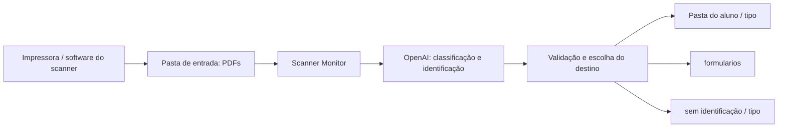

# Scanner Monitor

Organizador de documentos digitalizados, desenvolvido em **Go**, que monitora uma pasta de entrada, analisa PDFs com a **API da OpenAI** e organiza os arquivos por aluno e tipo de documento.

O objetivo é reduzir o trabalho manual depois de usar o scanner de uma impressora: em vez de procurar arquivos avulsos e separar cada documento, o programa organiza os PDFs conforme seu conteúdo.

> **Status:** projeto em desenvolvimento. Os diretórios são configurados pelo `.env`, e 20 workers processam os PDFs continuamente. Consulte as [limitações atuais](#limitações-atuais) antes de usar.

## Sumário

- [Como funciona](#como-funciona)
- [Categorias de documentos](#categorias-de-documentos)
- [Tecnologias](#tecnologias)
- [Pré-requisitos](#pré-requisitos)
- [Instalação e configuração](#instalação-e-configuração)
- [Execução](#execução)
- [Estrutura do projeto](#estrutura-do-projeto)
- [Verificação](#verificação)
- [Limitações atuais](#limitações-atuais)
- [Solução de problemas](#solução-de-problemas)
- [Cuidados antes de publicar no GitHub](#cuidados-antes-de-publicar-no-github)
- [Próximas melhorias](#próximas-melhorias)

## Como funciona

1. O software da impressora salva os documentos digitalizados em PDF na pasta de entrada.
2. O Scanner Monitor verifica essa pasta a cada **dois segundos**.
3. Cada novo PDF é aberto e enviado à API da OpenAI.
4. O modelo analisa todas as páginas e retorna a categoria, a identificação do titular e a indicação de formulário em branco em JSON, usando um schema estrito com opções predefinidas.
5. O domínio valida os dados e monta o destino: pasta do aluno, `formularios` ou `sem identificação`, conforme as regras abaixo.
6. O PDF é **movido**, preservando o nome original quando disponível. Colisões recebem sufixos numéricos, sem sobrescrever o arquivo existente.



O programa trabalha com os arquivos gerados pelo scanner. A digitalização e a escolha da pasta onde a impressora salva os PDFs são configuradas no software da impressora; não há controle direto do equipamento nesta implementação.

Somente PDFs na raiz da pasta de entrada são considerados. A extensão é reconhecida sem distinção entre maiúsculas e minúsculas; subpastas são ignoradas.

## Categorias de documentos

As categorias estão definidas no schema em `internal/infra/ai/chatgpt.go` e validadas em `internal/domain/model.go`:

| Categoria | Tipo de documento |
| --- | --- |
| `identidade` | RG, CIN e outros documentos oficiais de identidade |
| `certidao_nascimento` | Certidões de nascimento |
| `prontuario` | Prontuários e fichas do aluno ou paciente |
| `atestado` | Atestados |
| `carteira_vacinacao` | Carteiras de vacinação |
| `historico_escolar` | Históricos escolares |
| `documento_aluno` | Documentos de alunos |
| `formulario` | Formulários em branco ou preenchidos sem outro tipo específico |
| `outro` | Documentos que não se enquadram nas demais categorias |
| `documentos_mistos` | PDF com vários tipos de documento sem um tipo principal |

A IA extrai `classification_name`, `is_blank_form`, `holder_role`, `identification_status`, `holder_name`, `holder_cpf`, `record_number` e `identification_evidence`. O nome precisa ser completo e legível, associado ao aluno ou titular, com um trecho de evidência do documento. Os estados de identificação são `identificado`, `ausente`, `ilegivel` e `ambiguo`; os papéis são `aluno`, `titular`, `responsavel` e `indeterminado`.

As instruções em `internal/infra/ai/prompt.go` orientam a IA a distinguir o titular dos pais, responsáveis, médicos e signatários. Na certidão, o titular é a pessoa registrada; no atestado, é o paciente. Um PDF com documentos do aluno e do responsável só pode usar os dados do aluno quando a relação estiver explícita. CPF e prontuário precisam pertencer à mesma pessoa do nome; a IA não deve completar nomes ou adivinhar manuscritos ilegíveis.

O programa monta as pastas após validar a resposta; a IA não fornece caminhos. A evidência retornada precisa conter o nome completo selecionado. CPF e prontuário divergentes ou sem comprovação nessa evidência são descartados, preservando o nome seguro. O nome é convertido para letras minúsculas, sem acentos, espaços ou pontuação. A identificação segue esta ordem:

1. `nomecompletodoaluno_CPF`, com CPF sem pontuação e dígitos verificadores válidos.
2. `nomecompletodoaluno_prontuario_NUMERO`, quando não há CPF válido e há número de prontuário utilizável.
3. `nomecompletodoaluno`, quando o nome está identificado com segurança, mas não há CPF nem prontuário utilizável.

Os zeros iniciais dos identificadores são preservados. Separadores internos de prontuário, como em `2026/0012`, são adaptados para um nome de pasta seguro (`2026-0012`).

Identidade, certidão de nascimento, prontuário e `documento_aluno` ficam diretamente na pasta da pessoa. Carteira de vacinação, histórico escolar, atestado, formulário preenchido, `outro` e `documentos_mistos` recebem uma subpasta com a categoria.

Formulários destinados à impressão só vão para `formularios` quando **todas as páginas** forem modelos sem preenchimento pessoal. Assinaturas, caixas marcadas, datas preenchidas ou registros de doses tornam o documento preenchido, mesmo que o nome esteja ausente ou ilegível. Dados fixos da instituição e exemplos explicitamente fictícios não identificam uma pessoa.

Documentos sem nome completo seguro, com identificação ilegível ou ambígua, ou explicitamente apenas de responsável, vão para `sem identificação/tipo`. Um PDF com vários alunos sem um titular inequívoco também segue esse destino para revisão manual. O arquivo permanece inteiro; o programa não divide páginas.

Exemplo de organização com dados fictícios:

```text
organizados/
├── joaodasilva_52998224725/
│   ├── identidade.pdf
│   ├── certidao.pdf
│   ├── carteira_vacinacao/
│   │   └── vacinas.pdf
│   └── atestado/
│       └── atestado.pdf
├── anasouza_prontuario_00123/
│   ├── prontuario.pdf
│   └── historico_escolar/
│       └── historico.pdf
├── pedrosantos/
│   └── ficha_escolar.pdf
├── formularios/
│   └── ficha_para_impressao.pdf
└── sem identificação/
    ├── carteira_vacinacao/
    │   └── vacinas_nome_ilegivel.pdf
    └── identidade/
        └── documento_responsavel.pdf
```

As pastas e a pasta base de saída são criadas conforme necessário. A análise considera apenas o PDF atual: não cruza dados entre arquivos independentes nem mantém um cadastro de alunos.

O upload e a análise usam entrada de PDF com detalhe visual `high` e saída estruturada estrita. Consulte a documentação oficial de [entrada de arquivos PDF](https://developers.openai.com/api/docs/guides/file-inputs) e [Structured Outputs](https://developers.openai.com/api/docs/guides/structured-outputs?api-mode=responses). O schema restringe o formato da resposta; a leitura e a atribuição dos dados ainda dependem do modelo e da qualidade da digitalização.

## Tecnologias

| Tecnologia | Uso |
| --- | --- |
| Go | Aplicação, concorrência e operações no sistema de arquivos |
| `github.com/openai/openai-go/v3` | Upload dos PDFs e análise pela Responses API |
| `github.com/spf13/viper` | Leitura do arquivo `.env` |
| `github.com/invopop/jsonschema` | Geração do schema da classificação |

## Pré-requisitos

- Go **1.26.6**, versão declarada no `go.mod`, ou uma versão posterior compatível.
- Git para clonar o repositório.
- Chave de API da OpenAI com acesso ao modelo escolhido e crédito ou faturamento disponível.
- Modelo compatível com entrada de PDF e saída estruturada em JSON Schema.
- Acesso à internet para baixar dependências e realizar chamadas à API.
- Permissões de leitura na pasta de entrada e de escrita na pasta de saída.
- Impressora ou software de digitalização capaz de salvar documentos em PDF.

Os caminhos do arquivo de exemplo são de Windows. Adapte-os ao seu computador antes de executar.

## Instalação e configuração

### 1. Clonar e baixar dependências

Substitua a URL abaixo pela URL do seu repositório:

```powershell
git clone https://github.com/SEU_USUARIO/scanner-monitor.git
cd scanner-monitor
go mod download
```

### 2. Criar o arquivo `.env`

Na raiz do projeto, copie o arquivo de exemplo. O nome existente no repositório é `.env.exemple`:

```powershell
Copy-Item .env.exemple .env
```

Preencha as quatro variáveis:

```dotenv
CHATGPT_SDK_KEY=sua_chave_de_api
MODEL_OPENAI=id_do_modelo_compativel
FILE_PATH_BASE=C:\Scanner\entrada
DIR_PATH_BASE=C:\Scanner\organizados
```

| Variável | Descrição | Obrigatória |
| --- | --- | --- |
| `CHATGPT_SDK_KEY` | Chave de API utilizada para enviar e analisar os PDFs | Sim |
| `MODEL_OPENAI` | Identificador do modelo usado na classificação | Sim |
| `FILE_PATH_BASE` | Pasta de entrada dos PDFs | Sim |
| `DIR_PATH_BASE` | Pasta base de saída da organização por aluno e tipo | Sim |

Os valores acima são placeholders: substitua-os por credenciais e um modelo disponíveis na sua conta. O programa rejeita valores vazios.

O arquivo `.env` deve existir no **diretório de trabalho da execução**. Na configuração atual, a leitura desse arquivo é obrigatória, mesmo quando há variáveis de ambiente no sistema.

### 3. Ajustar os diretórios

Configure `FILE_PATH_BASE` e `DIR_PATH_BASE` no `.env`. Prefira caminhos absolutos. O monitor normaliza a barra final da entrada antes de procurar PDFs.

Crie a pasta de entrada antes de iniciar (a saída será criada automaticamente):

```powershell
New-Item -ItemType Directory -Force -Path 'C:\Scanner\entrada'
```

Configure o software do scanner para salvar seus PDFs em `C:\Scanner\entrada`. Use uma pasta de saída separada. A movimentação grava um temporário `.scanner-*.partial`, sincroniza o conteúdo e publica o PDF completo por hard link sem sobrescrever o destino. A origem só é removida após a publicação. Entrada e saída podem estar em volumes distintos; o volume de saída precisa suportar hard links, como NTFS. Se não suportar, a movimentação retorna erro e preserva a origem.

### Arquivos repetidos

Se `scan.pdf` já existir na pasta de destino com conteúdo diferente, o novo arquivo será salvo como `scan (1).pdf`, depois `scan (2).pdf`, e assim por diante. A criação exclusiva impede sobrescritas mesmo com chamadas concorrentes. O SHA-256 é comparado com PDFs na mesma pasta de destino: quando já existe conteúdo idêntico, nenhuma nova cópia é publicada e a origem fica preservada. A detecção é local à pasta de destino, não global.

Durante o monitoramento, um PDF já enviado não é reenviado enquanto sua identidade, tamanho e data de modificação permanecerem iguais. Um arquivo substituído ou alterado no mesmo caminho volta a ser elegível. Esse controle fica em memória e é reiniciado com a aplicação.

### Recuperação e acompanhamento

Cada etapa (classificação, criação de pasta e movimentação) tem até três tentativas, com esperas de um e dois segundos. A classificação já obtida é reutilizada quando apenas a pasta ou a movimentação falha. Cada tentativa recebe um contexto com prazo de um minuto; a cópia e as chamadas à API respeitam o cancelamento. Após esgotar as tentativas, o erro é registrado e os demais arquivos continuam. O PDF permanece na entrada quando ainda não foi movido; para tentar novamente depois de resolver a causa, reinicie o monitor ou substitua o arquivo. A fila de tentativas fica em memória.

Falhas ao acessar a pasta de entrada são registradas, e o monitor tenta restabelecer a leitura. Configuração inválida impede a inicialização. `Ctrl+C` interrompe novas tentativas e solicita o encerramento dos trabalhos em andamento.

Antes do upload, o PDF precisa manter identidade, tamanho e data de modificação em duas verificações consecutivas (intervalo padrão de dois segundos), ter cabeçalho `%PDF-` e terminar em `%%EOF`. Isso reduz o risco de ler arquivos em gravação, mas é uma heurística: não substitui um parser PDF nem garante que outro programa não reabra o arquivo. Alterações durante a classificação ou cópia são detectadas e retornam erro.

O terminal mostra o arquivo em processamento, leitura do PDF, upload, espera pela resposta da IA, categoria recebida, preparação da pasta, tentativas e resultado da movimentação. O destino final é informado mesmo quando o nome recebe um sufixo. A organização é automática; a qualidade da classificação e da identificação depende do modelo e do documento.

## Execução

Execute a partir da raiz do projeto, onde está o `.env`:

```powershell
go run ./cmd/cli
```

Depois, digitalize um documento ou coloque um PDF completo na pasta de entrada. Após a análise, o arquivo deve aparecer no destino correspondente ao aluno, formulário em branco ou documento sem identificação.

Também é possível compilar e executar no Windows:

```powershell
go build -o scanner-monitor.exe ./cmd/cli
.\scanner-monitor.exe
```

Ao alterar o `.env`, reinicie o executável. Use `Ctrl+C` para solicitar o encerramento do processo. O programa funciona pelo terminal e não oferece interface gráfica ou servidor HTTP.

### Dados enviados à API

O conteúdo completo dos PDFs é enviado à OpenAI para classificação. As chamadas podem gerar custos de upload, processamento ou uso do modelo conforme as condições do serviço. Considere o conteúdo dos documentos antes de processá-los, especialmente atestados e dados de alunos.

A aplicação não implementa exclusão dos arquivos enviados à API depois da análise. Confira as regras de armazenamento do serviço e as necessidades de privacidade do seu uso.

## Estrutura do projeto

```text
scanner-monitor/
├── cmd/
│   └── cli/
│       └── main.go                  # Inicialização e tratamento de erros
├── internal/
│   ├── config/
│   │   └── config.go                # Carregamento do .env com Viper
│   ├── domain/
│   │   ├── model.go                 # Identificação, validação e destinos
│   │   └── repository.go            # Contratos de IA e sistema de arquivos
│   ├── infra/
│   │   ├── ai/
│   │   │   ├── chatgpt.go            # Upload, análise e JSON Schema
│   │   │   └── prompt.go             # Regras de classificação e titular
│   │   └── filesystem/
│   │       └── filesystem.go         # Busca, criação de pastas e movimentação
│   └── worker/
│       └── monitor.go               # Coordenação dos workers
├── .env.exemple                     # Modelo de configuração sem credenciais
├── .gitignore
├── go.mod
├── go.sum
└── README.md
```

O domínio define os contratos consumidos pelo monitor, enquanto as implementações de infraestrutura realizam chamadas à API e operações em disco. A interface de IA `OpenAIRepository`.
~~~~
## Verificação

Para executar os testes automatizados e gerar cobertura:

```powershell
go test ./... '-coverprofile=coverage.out'
go tool cover '-func=coverage.out'
```

Os testes usam diretórios temporários, repositórios simulados e um servidor HTTP local. Cobrem configuração e sobrescrita por variáveis de ambiente; validação da identificação e escolha dos destinos; formulários em branco e documentos sem identificação; CPF inválido; classificação vazia; credenciais ausentes; falhas de upload e análise; JSON inválido; cancelamento; criação de pastas; colisões de nomes; movimentação concorrente; preservação da origem em erros; filtragem de PDFs; substituição de arquivos; processamento contínuo e encerramento dos workers. Não usam credenciais reais nem chamam a OpenAI. Respostas simuladas verificam as regras do programa, mas não garantem a leitura real de documentos antigos ou manuscritos.

Também é possível verificar condições de corrida com `go test -race ./...`, quando houver suporte do compilador C e da plataforma. Os testes não simulam todas as falhas possíveis do sistema operacional, como disco cheio ou interrupção de energia, e não validam a qualidade da classificação real.

Para verificar o fluxo completo, use PDFs de teste, configure as pastas e execute a aplicação. Confira se o arquivo sai da entrada, mantém seu nome e aparece no destino esperado. Inclua casos de aluno e responsável no mesmo PDF, manuscrito ilegível, formulário totalmente vazio, formulário parcialmente preenchido e documento sem identificação. Essa verificação realiza chamadas reais à API.

## Limitações atuais

- **Novas tentativas em memória:** há três tentativas por etapa, sem fila persistente. Falhas definitivas precisam de intervenção ou reinício para reprocessar o mesmo arquivo.
- **Colisões de pastas:** diretórios são criados automaticamente, mas um arquivo existente no lugar de uma pasta não é substituído; a falha é registrada.
- **PDF em gravação:** estabilidade e marcadores são heurísticas, sem validação completa da estrutura do PDF. Arquivos vazios, incompletos ou sem os marcadores ficam aguardando na entrada.
- **Interrupção da cópia:** uma queda pode deixar um `.partial` que não é tratado como PDF. A publicação do destino é exclusiva, mas publicação e remoção da origem não constituem uma única transação. Se a remoção falhar, ambas as cópias são preservadas, e as novas tentativas detectam a duplicata. Temporários deixados por uma interrupção precisam de limpeza manual com o monitor parado.
- **Deduplicação:** considera PDFs na mesma pasta de destino; a origem idêntica fica preservada para decisão manual. Não há índice persistente nem comparação entre pastas.
- **Classificação e identificação:** a organização é automática; a IA não garante uma categoria ou um titular correto. A validação do domínio verifica formato e coerência dos campos, mas não confirma que a transcrição corresponde ao documento.
- **Responsável em arquivo separado:** uma identidade isolada com titular inequívoco pode não indicar que a pessoa é responsável. Sem contexto explícito no próprio PDF, a aplicação não consegue vincular esse documento ao aluno nem reconhecer esse papel com segurança.
- **Sem cadastro de alunos:** arquivos independentes não compartilham identificação. O mesmo aluno pode receber pastas distintas quando um PDF contém CPF e outro apenas prontuário ou nome; não há vínculo automático entre esses destinos. Pastas com apenas o nome podem agrupar homônimos.
- **PDF com várias pessoas:** não há separação de páginas. Documentos com alunos conflitantes vão inteiros para `sem identificação/tipo`, exigindo revisão manual.
- **Encerramento:** erros por arquivo não cancelam o monitor. O canal de erros fecha após o encerramento das goroutines; chamadas e operações do sistema operacional precisam cooperar com o contexto para terminar prontamente.

## Solução de problemas

| Sintoma | O que verificar |
| --- | --- |
| Erro ao ler `.env` | Execute na raiz do projeto e confirme que o arquivo foi criado |
| Chave ou modelo não informado | Preencha `CHATGPT_SDK_KEY` e `MODEL_OPENAI` no `.env` |
| Nenhum PDF é processado | Confira `FILE_PATH_BASE` e coloque os PDFs na raiz da pasta |
| Erro ao enviar ou analisar o PDF | Confira conexão, credenciais, acesso ao modelo, limites da API e integridade do arquivo |
| Documento em `sem identificação` | Verifique legibilidade, nome completo do titular, vínculo dos dados e se há apenas um aluno identificável no PDF |
| Mesmo aluno em pastas diferentes | Confira quais PDFs têm CPF, prontuário ou somente nome; a aplicação não vincula esses identificadores entre arquivos |
| Erro ao mover o arquivo | Confira permissões, pasta base de saída e espaço disponível; colisões de nome recebem sufixos |

## Cuidados antes de publicar no GitHub

- Mantenha a chave apenas no `.env`, que já está listado no `.gitignore`.
- Não inclua PDFs reais, dados pessoais ou credenciais no repositório.
- O `main.exe` consta como arquivo rastreado pelo Git nesta versão. Uma entrada no `.gitignore` não remove arquivos já rastreados. Se quiser publicar apenas o código, remova o executável do índice, preservando sua cópia local:

  ```powershell
  git rm --cached -- main.exe
  ```

- O comando de compilação deste README gera `scanner-monitor.exe`. Adicione esse nome ou `*.exe` ao `.gitignore` se não quiser versionar os próximos builds.
- Revise os arquivos de configuração da IDE em `.idea/`, atualmente rastreados, antes de publicar.
- O projeto ainda não inclui um arquivo de licença. Defina uma licença caso queira explicitar as condições de uso, modificação e distribuição.

## Próximas melhorias

Sugestões para evoluir a implementação:

- Configurar intervalo de monitoramento e quantidade de workers pelo `.env`.
- Adicionar fila persistente de tentativas e índice de deduplicação entre categorias.
- Ampliar testes para falhas de disco e permissões em diferentes sistemas operacionais.
- Adicionar interface gráfica e gestão dos arquivos enviados à API.
